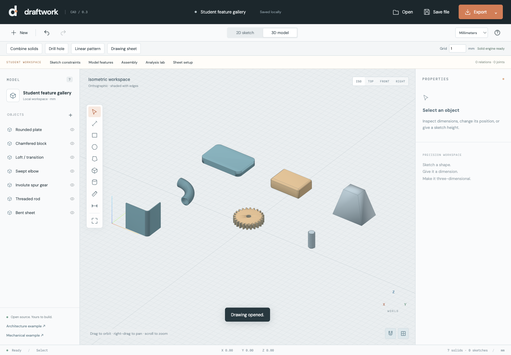

# Draftwork CAD 0.3

An MIT-licensed browser CAD workspace for engineering students: measured sketches,
simple solid modeling, assembly studies and engineering calculations. Built for
saintix4612 with assistance from OpenAI Codex. Independent of Autodesk/AutoCAD.



## Open the app

Open `Draftwork-CAD.html` from a packaged build in a modern desktop browser.
It includes its 3D engine and needs no developer tools, account, or server.
Google Fonts are optional; system fonts work offline. WebGL and WebAssembly
must be available. Download drawing files as backups of browser autosave.

To edit the source, install Node.js 22.12+ (or 20.19+), then:

```sh
npm ci
npm run dev
npm test
npm run build
```

The build produces `dist/index.html` for static hosting and
`dist/Draftwork-CAD.html` as a standalone file. Source licenses are embedded in
the standalone file and also included under `dist/licenses/`.

## Student workflow

1. **Sketch.** Draw lines, rectangles, circles or closed polygons on XY. Select
   an object and enter measurements, including expressions such as `1/4 in` or
   `(30+20)*2`. Choose mm, cm, m or inches for the inspector; saved geometry is mm.
2. **Constrain.** Open Sketch constraints for lines, circles and rectangles at
   Z=0. Set horizontal/vertical, length/radius/width/depth, parallel/perpendicular,
   equal, concentric, coincident endpoints, center/start distance, or fixed.
   Edit driving dimensions in the relation list. Conflicting edits are rejected.
   The built-in exercise demonstrates equal parallel lines and concentric circles.
3. **Model.** Extrude rectangles, circles or polygons; add boxes/cylinders;
   union, subtract or intersect bodies; drill a world-Z through-hole; repeat
   objects in a linear pattern. Edit XYZ position and XYZ rotation.
4. **Use features.** Model features creates rounded plates, chamfered blocks,
   rectangular lofts, swept tube elbows, involute spur gears, geometric threaded
   rods and a single-bend sheet. Reopen the panel on a generated part to edit
   its parameters. Sheet development uses `BA = angle × (inside radius + K × thickness)`.
5. **Assemble.** Position parts and attach a moving body to a parent using a
   fixed, revolute or slider joint. Joint axes and origins belong to the parent.
   Use a slider to save a new pose, preview motion, check overlapping volume,
   or inspect an exploded view. Closing the panel resets display-only previews.
6. **Study.** Analysis lab has a 20-element Euler–Bernoulli beam model, a 2D
   pin-jointed truss stiffness solver and 1D steady heat conduction. Assumptions,
   units, numerical results and downloadable JSON reports are provided.
7. **Draw and export.** Place linear dimension annotations with D. In Sheet setup,
   edit annotation offsets/tolerances, the title block, circular center marks,
   sampled hidden edges and a horizontal section cut. Save an A4 SVG sheet or
   print to PDF at actual size. Export STL/OBJ solids and SVG/DXF top outlines.

## Controls and files

Click twice for a line, rectangle, circle or dimension. For a polygon, click its
vertices and press Enter to close it. Shift locks the current drawing segment
to an axis. Grid spacing is adjustable, with proximity snapping to sketch points.
The displayed grid lines remain 10 mm apart regardless of the snap spacing.

ISO: left-drag orbits, right-drag pans, scroll zooms. Top/front/right: left-drag
pans. F fits the drawing. V/L/R/C/P/B/Y/M/D select tools; Esc cancels drawing;
Delete removes selection; Cmd/Ctrl Z undoes; Cmd/Ctrl Shift Z redoes;
Cmd/Ctrl D duplicates; Cmd/Ctrl S downloads a drawing.

`.draftwork` files include objects, feature parameters, constraints, joints and
sheet settings. New files use format version 2 so older editors do not silently
discard these features. Existing version-1 drawings remain readable. Open also accepts
ASCII DXF LINE, CIRCLE and straight LWPOLYLINE entities in supported units.
Unsupported DXF entities are reported explicitly; unitless DXF is treated as mm.

STL is unitless: import its coordinates as millimeters. Separate bodies remain
separate unless explicitly joined. DXF export contains geometry outlines only;
use SVG/PDF sheets for dimensions and annotations.

## Scope and limits

This is an early, mesh-based study application, not a complete professional CAD
or simulation package.

- Constraints cover simple XY sketches, up to 80 relations / 180 variables.
  There is no degrees-of-freedom report, tangent/symmetry constraint, or automatic
  feature dependency tree. A constrained sketch's extrusion is an independent copy.
- Rounded/chamfered features are dedicated generators, not arbitrary mesh-edge
  fillets. Lofts use two rectangular profiles; sweeps use circular tube arcs.
  Threads have no standardized fit allowance. Gears have approximate root relief.
  Sheet metal is limited to one 90° bend; there is no general unfolding solver.
- Boolean results are saved meshes. Generated feature parameters remain editable
  until the feature is converted through another modeling operation.
- Assemblies are acyclic single-parent joint chains, up to 60 joints. Motion is
  kinematic, not a gravity/contact/dynamics simulation. Interference checks cover
  up to 40 visible bodies, detect overlapping volume and exclude mere touching.
- Analysis does not mesh arbitrary CAD solids. Beam/truss models are linear and
  exclude buckling, joints, stress concentrations and nonlinear material response.
  Yield safety factors cover only the displayed idealized stress. Thermal analysis
  excludes convection, radiation and transients. There is no airflow/CFD solver.
- Drawing dimensions are independent annotations, not associative references.
  Sections are horizontal XY cuts. Hidden edges use eight visibility samples per
  sharp mesh edge; very short visibility changes may be missed. This mode is
  limited to 40 bodies / 50,000 triangles. GD&T, arbitrary sections, drafting
  standards certification, and general automatic hole recognition are absent.
- No DWG, STEP, IGES, native SolidWorks/Fusion files, cloud collaboration or
  project server. Imports are capped at 10 MB, drawings at 2,000 objects and
  200,000 mesh triangles. Boolean/feature results are capped at 100,000 triangles.

## Verification

`npm test` compares operations against analytic volumes, solves/rejects sketch
relations, exercises saved-file validation, checks assembly poses and interference,
compares beam results with closed-form solutions, verifies truss equilibrium and
Fourier heat conduction, and checks projection axes and annotated section sheets.
See `VALIDATION.md` for the browser checks performed for this release.

## Contributing and credits

Contributions are welcome. Include reproduction steps for bugs, tests for numerical
changes, and before/after screenshots for UI work. Disclose AI assistance and
verify generated changes. Keep educational assumptions visible in analysis tools.

- [Three.js](https://threejs.org/) — MIT; rendering, controls and mesh exporters.
- [Manifold](https://github.com/elalish/manifold) — Apache-2.0; solid geometry,
  booleans, sections, projections and mesh validation.
- [Vite](https://vite.dev/) — MIT; development and build tooling.
- DM Sans and IBM Plex Mono — SIL Open Font License; optional Google Fonts.

Draftwork source is MIT licensed. Dependencies retain their authors' licenses.
